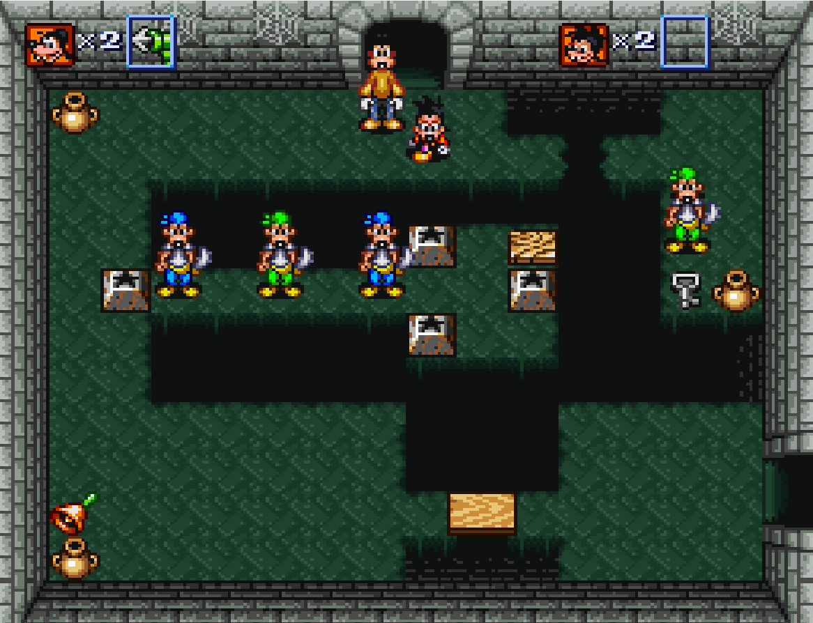
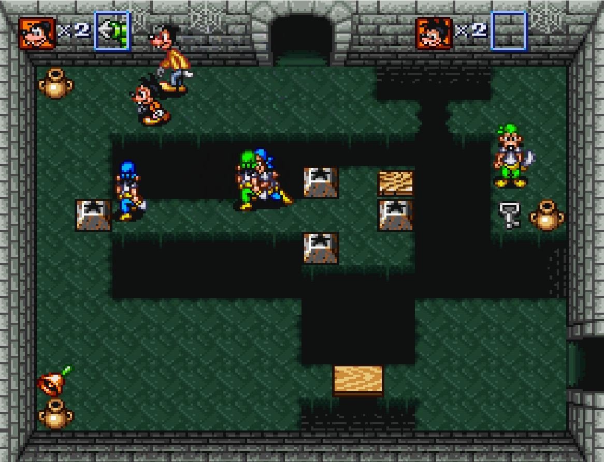
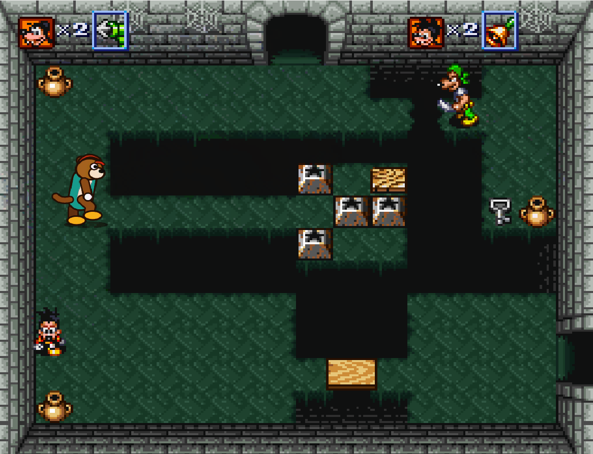
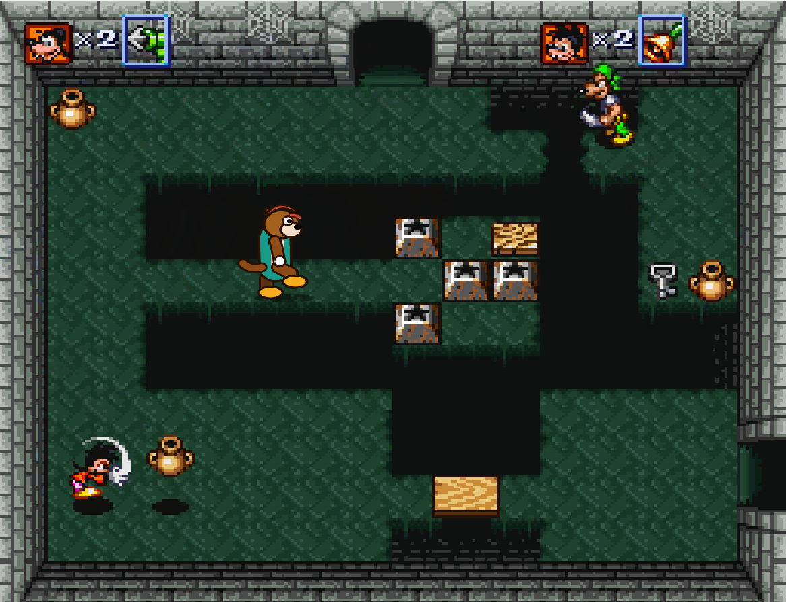

# Sprite pack: replace SNES sprites with high-resolution images

A fork of [bsnes](https://github.com/bsnes-emu/bsnes) (v115) that adds a *texture-pack*-style feature to the `ppu-fast` renderer.
The game's sprites are grouped into characters, and each recognized group is replaced by a high-resolution PNG
drawn in an enlarged frame (4x by default, 1024x960), respecting the game's priority and layers.

The bundled pack is an original character, the **Otter** (`lontra` in Portuguese), that stands in for the player in
**Goof Troop (USA)**. This is a proof of concept.

## Before and after

Original sprites:




With the Otter pack:




> **You need a Goof Troop (USA) ROM.** It is **not** included in this repository or in the release,
> and it will not be provided. Use the ROM from your own cartridge. The pack only recognizes the USA version.

## Quick start (Windows, no compiling)

1. Download `bsnes-sprite-pack-v1.zip` from [Releases](https://github.com/jrussi/bsnes/releases) and extract it to a folder.
2. Have your **Goof Troop (USA)** ROM (`.sfc` or `.smc`) ready.
3. Double-click `rodar_com_pack.bat` ("run with pack"). **Do not open `bsnes.exe` directly**: without the `.bat` the pack is not loaded.
4. In bsnes, choose *System > Load Game...* and pick the ROM. You can also drag the ROM onto `rodar_com_pack.bat`.
5. Play. When the player character (side, front or back, walking or standing) is recognized, it appears as the Otter.
   The default renderer (`ppu-fast`) is the one used, so there is nothing to change in the settings.

## Building from source

1. Install the tools and build (MSYS2 MINGW64):
   ```
   pacman -S --needed mingw-w64-x86_64-gcc make
   cd bsnes
   make -j8 openmp=false
   ```
   The executable is written to `bsnes/out/bsnes.exe`.
2. Run `sprite-pack/rodar_com_pack.bat` and load the ROM from the menu, or pass it on the command line:
   ```
   sprite-pack\rodar_com_pack.bat "C:\path\Goof Troop (USA).sfc"
   ```

The batch file only sets `BSNES_SPRITE_PACK` to `sprite-pack\lontra` and starts `bsnes.exe`. Without that variable, bsnes behaves like the original.

## Limitations

- Works only with the `ppu-fast` renderer (the default) in normal mode (no hires, interlace or HD Mode 7).
- With the pack active, the frame is output enlarged (the pack's scale) and bsnes' software filters are disabled.
- Group ids are hashes of the game's sprite pieces, so the bundled pack only recognizes Goof Troop (USA).
  Poses that are not in the pack show the original sprite.
- Proof of concept: only the mapped poses of the player are replaced. Enemies and items are not.

## How it works

- **Groups:** sprites whose boxes touch (within 1 pixel) form a group. A group id is an FNV-1a 64-bit hash of its pieces
  (tile hash, offset, flips and size).
- **Composition:** a recognized group is erased from the native frame and drawn again from its PNG at the pack's scale, with the original priority.
- **Pack format:** `pack.txt` has one line per group, `id png scale width height margin`.
  `width` and `height` are the PNG size in pixels, `margin` is the extra border in native pixels (8 in the bundled pack),
  and all lines must use the same scale (2 to 8).

## Environment variables

- `BSNES_SPRITE_PACK`: folder with `pack.txt` and the PNGs. While it is active, the emulator also writes `recognized-*.csv` and
  `unrecognized-*.csv` there (groups seen that are, or are not, in the pack), which show which poses are still missing.
- `BSNES_SPRITE_DUMP`: an existing folder. Writes every sprite piece as a PNG, plus `manifest.csv` and `frames-*.csv` (the pieces of each frame).
  Useful for building new packs.

## Creating or regenerating a pack

Tools are in `sprite-pack/tools` (Python 3, `librsvg` with `rsvg-convert`, and Pillow):

- `listar_grupos.py frames.csv grupos.json` lists the sprite groups seen in a dump.
- `render_pack.py tabela.json grupos.json output_folder [scale]` renders the SVGs in `svg/` to PNG with the right margin and writes `pack.txt`.
  `tabela.json` links each group id to the SVG that replaces it, and each SVG viewBox must match its group size in native pixels.
- `lontra.py` and `lontra2.py` generate the Otter SVGs (side, front and back poses).

The bundled pack was generated with `python3 render_pack.py tabela.json grupos.json ../lontra 4`.

## Emulator files changed

- `bsnes/sfc/ppu-fast/spritedump.cpp` (new): dump, grouping, pack loading and composition.
- `bsnes/sfc/ppu-fast/ppu.cpp`, `ppu.hpp`, `line.cpp`: hooks for the dump and a second pass without sprites (`skipObjects` and `renderRedirect`).
- `nall/arithmetic.hpp`: adds `#include <stdexcept>`, which recent GCC needs to build.

## License

GPLv3 or later, same as bsnes. The Otter images are original to this fork.
